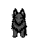
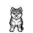
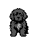

# Pokedogs

**Pokémon Red, with dogs.**

Explore Kanto with a pack of canine companions. Pokedogs replaces all 151 Pokémon with dog forms inspired by 79 breed families, from playful puppies to powerful guardians. Earn all eight badges, challenge the Elite Four and Champion, and discover the rare dogs of Cerulean Cave.

## Choose your starter

| Groenendael | Shiba Inu | Newfoundland |
| :---: | :---: | :---: |
|  |  |  |
| **Grass** · GROENPUP | **Fire** · SHIBAPUP | **Water** · NEWFPUP |

## What changes

- **A dog Pokédex:** new sprites, stats, evolutions, and learnsets, with full breed names in the Pokédex.
- **165 dog-themed moves:** the original 15 types and all five HM field functions are preserved.
- **All 151 in one ROM:** no trading or version exclusives. Uncaught guardians return after another Hall of Fame entry.

## Build and play

Install the [build dependencies](INSTALL.md), using **RGBDS 1.0.4**, then run:

```sh
make -j4 demo
```

Open `build/pokedogs-demo.gb` in a Game Boy emulator, such as SameBoy.

The full adventure and postgame are implemented. Balance, presentation polish, and continuous playtesting are still in progress.

## Explore the mod

- [Collection guide](docs/COLLECTION.md) — where to find every dog form.
- [Roster](docs/ROSTER.md) and [moves](docs/MOVES.csv) — breeds, types, stats, evolutions, and move details.
- [Development notes](docs/DEMO.md) — implementation scope, builds, and automated checks.
- [Design plan](docs/FULL_GAME_PLAN.md) — the rules behind the roster and progression.
